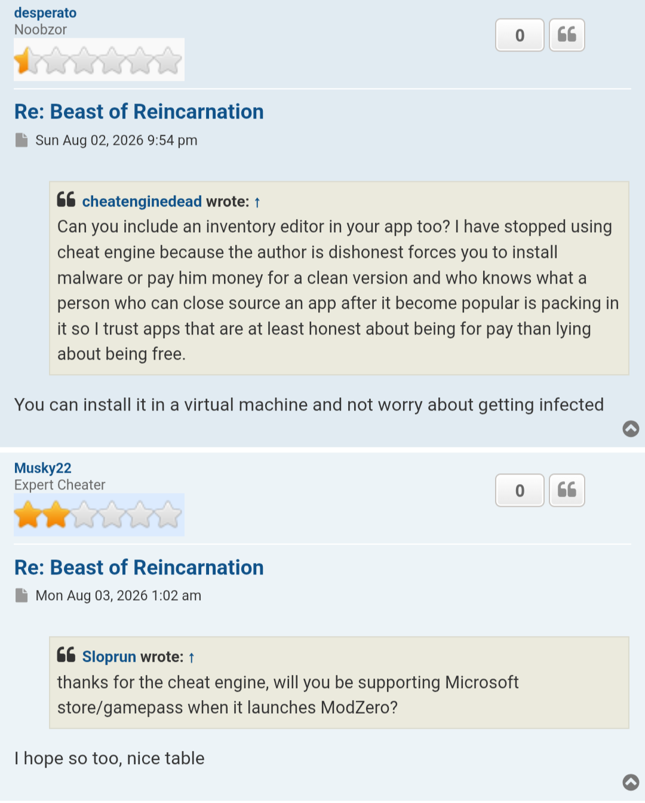

## Introduction
Hello again! 

Today, I want to talk about just how reckless Fearless Revolution has become and share some proof that digs their reputation even deeper—assuming they even have one left at this point.

## Are the Users Just Bots?!
Honestly, yes, or at the very least, they're automated accounts set up just to shower "modders" with fake praise. They constantly hype up how useful these tables are, even when the files are nothing more than hollow redirects pushing you toward their bloatware app.

This whole mess started when the site's top table creators refused to lock their work behind a paywall. In response, the admins either banned them outright or scrambled their usernames into random pseudonyms. From there, the administration actively gutted real content—stripping out actual links, tables, and features—and swapped them with dummy tables designed purely to force downloads of their paid app, "ModEngine."

I remember reading an article a while back about how the site's maintenance costs were skyrocketing *(and honestly, part of me hopes it forces them to shut Fearless Revolution down for good)*. Back then, I actually wanted the site to pull through because of the sheer amount of time and effort the community had poured into building all those cheat tables. Now, though, the place has completely rotted into a wasteland of manufactured hype.

## Blame and Malice

If you look closely, you can see this post went up *after* my account details were messed with. In it, one of the bots—or an actual user, if any are even left—tries to blame **Eric** (Dark Byte, the creator of Cheat Engine) for taking Cheat Engine closed-source. The thing is, Eric had completely valid reasons for locking down the code, mostly because people were shamelessly exploiting his work for money without permission. Random third parties were compiling and distributing the source code without his official installer, cutting off the ad revenue that actually funded the project, while others were flat-out stealing the code to repackage and resell it as their own commercial software—which is the exact playbook "ModEngine" used.

At the end of the day, the site admins are only mad at Dark Byte because they can't easily cash in on his work anymore. Cut off from new source updates, they can't build new features for ModEngine, leaving their cash-grab app to slowly stall out and die.

## Conclusion
Looking back, the people running Fearless Revolution and "ModEngine" went corrupt a long time ago. I didn't catch on right away, which is unfortunate, so I'm laying it all out now to warn everyone else. You can't even register on the site anymore without an invite code—and whenever a supposedly public forum locks its doors behind invite-only access, you know something shady is happening behind the scenes.

Whatever you do, stay away from Fearless Revolution, skip their forums, and definitely don't download anything tied to "ModEngine." You really don't want that kind of bloatware anywhere near your PC.

Thanks for reading—it was a pleasure putting this together for you. Stay safe out there, and good luck!